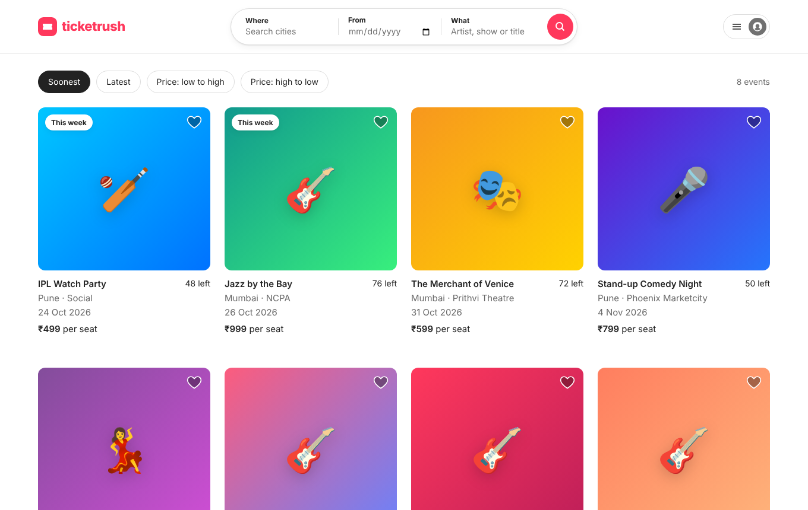
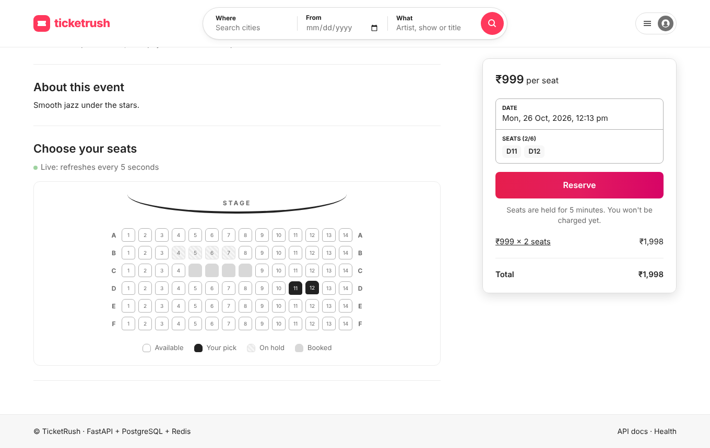
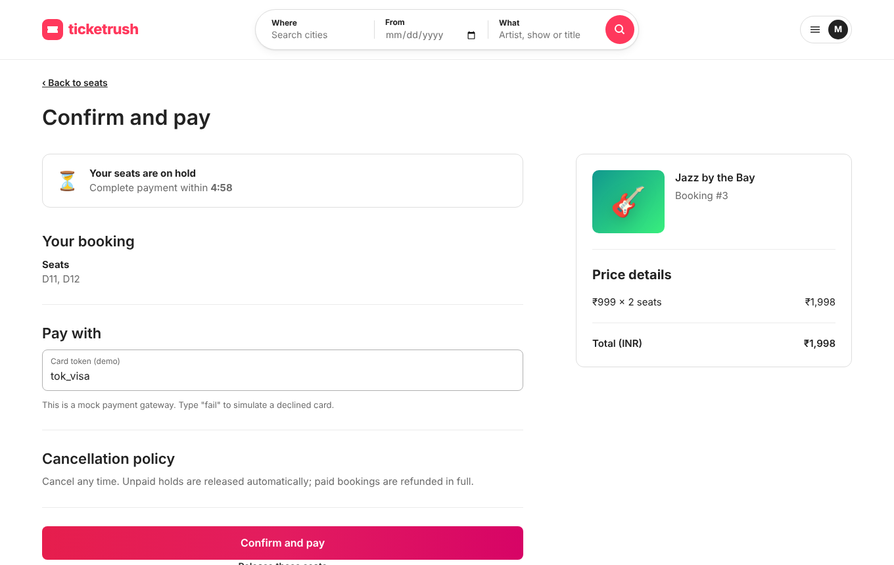
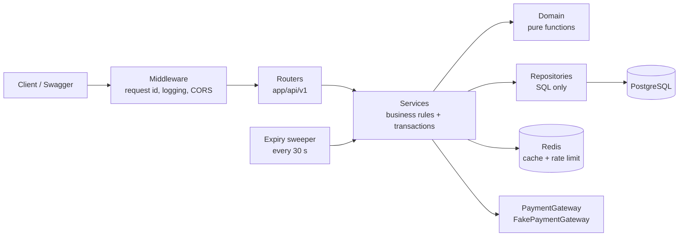

# TicketRush


TicketRush is a ticket-booking REST API built with **FastAPI, PostgreSQL and Redis**. Users register and log in with JWT, browse
events, **hold seats for 5 minutes**, pay through a mock payment gateway, or cancel. The core guarantee is that **the same seat is never
sold twice**, even when many people click "book" at the same moment. A database transaction with a row lock
(`SELECT ... FOR UPDATE SKIP LOCKED`) enforces it, and a 20-thread concurrency test proves it.

## UI

An Airbnb-style web app ships with the API (plain HTML/CSS/JS in `frontend/`, served by FastAPI at `/`, no build step):
search and sort events, pick seats on a live seat map, reserve, pay on a checkout page with the hold countdown, and manage bookings under **Trips**.
Admins get a **Host an event** page.

| Browse | Pick seats | Checkout |
|---|---|---|
|  |  |  |

## Architecture



Full design: [`docs/project-guide.md`](docs/project-guide.md).

## Run it in 3 commands (Docker)

```bash
cp .env.example .env                                  # then change JWT_SECRET
docker compose up --build -d                          # Postgres + Redis + API (runs migrations)
docker compose exec api python -m app.scripts.seed    # admin user + 8 sample events
```

Open **http://localhost:8000** for the app and **http://localhost:8000/docs** for Swagger. Seeded admin: `admin@ticketrush.dev` / `admin12345` (dev only; set `SEED_ADMIN_PASSWORD`).
In Swagger, call `POST /api/v1/auth/login`, copy `access_token`, click **Authorize** and paste it.

## Local development (without the API container)

Postgres and Redis still run in Docker; the API runs on your machine.

**Linux / macOS**

```bash
docker compose up -d db redis
python3.12 -m venv .venv
source .venv/bin/activate
pip install -r requirements-dev.txt
cp .env.example .env
alembic upgrade head
python -m app.scripts.seed
uvicorn app.main:app --reload
```

**Windows (PowerShell)**

```powershell
docker compose up -d db redis
py -3.12 -m venv .venv
.venv\Scripts\Activate.ps1
pip install -r requirements-dev.txt
Copy-Item .env.example .env
alembic upgrade head
python -m app.scripts.seed
uvicorn app.main:app --reload
```

## Tests

```bash
docker compose up -d db redis     # tests use the ticketrush_test database and Redis db 1
pytest -v                         # 77 tests: unit + integration + concurrency
ruff check . && ruff format --check .
```

- `tests/unit`: pure domain rules and JWT/bcrypt helpers, no database.
- `tests/integration`: the real API through FastAPI's `TestClient`, against real Postgres and Redis.
- `tests/integration/test_concurrency.py`: 20 threads book the same seat at the same moment, 5 rounds, exactly 1 wins each time.
  Removing `FOR UPDATE` from `app/repositories/seat_repo.py` makes it fail (in one run, 18 of 20 buyers "got" the seat).

### Live race demo

With the API running and seeded:

```bash
python scripts/race.py --users 50
```

Measured while building this project (single uvicorn process, 3 runs): `201: 1`, `409: 49` every time.
Re-run it on your machine and quote your own result.

## API

All routes are under `/api/v1` except `/health`. Errors always look like
`{"error": {"code": "SEAT_UNAVAILABLE", "message": "...", "request_id": "..."}}`.

| Method and path | Auth | Purpose |
|---|---|---|
| `GET /health` | - | Postgres and Redis status (503 only if Postgres is down) |
| `POST /auth/register` | - | Create a user (201, 409 if the email is taken) |
| `POST /auth/login` | - | Get a JWT (401; 429 after 5 failed attempts per minute per IP) |
| `GET /users/me` | user | Current user |
| `POST /events` | admin | Create an event and its seats (rows × seats per row) |
| `GET /events` | - | List with `city`, `q`, `from_date`, `to_date`, `sort`, `page`, `size` |
| `GET /events/{id}` | - | Event detail with `available_seats` (cached in Redis) |
| `PATCH /events/{id}` | admin | Partial update (invalidates the cache) |
| `GET /events/{id}/seats` | - | Seat map |
| `POST /bookings` | user | Hold 1-6 seats; header `Idempotency-Key` required (201, 409, 429) |
| `POST /bookings/{id}/pay` | owner | Pay; token `"fail"` simulates a decline (200, 402, 409) |
| `POST /bookings/{id}/cancel` | owner | Cancel; frees seats, refunds if confirmed |
| `GET /bookings` | user | My bookings, newest first, paginated |
| `GET /bookings/{id}` | owner | One booking (404 if it is not yours) |

## Key design decisions

- **Pessimistic locking for seats.** `FOR UPDATE SKIP LOCKED` with `ORDER BY id` in one transaction. Hot rows with many buyers
  favour locking over optimistic retries. `SKIP LOCKED` answers 409 at once instead of making buyers wait, and ordered locking prevents deadlocks.
- **Idempotency key + unique constraint.** `(user_id, idempotency_key)` is unique, so a retried or double-clicked request returns the
  first booking instead of creating a second one.
- **PostgreSQL is the source of truth; Redis is an optimisation.** The cache and the rate limiter fail open: with Redis down the API is
  slower, never wrong.
- **Layered code with dependency injection.** Router → service → repository, pure domain functions, and a `PaymentGateway`
  interface, so every layer can be tested alone and the fake payment provider can be swapped for a real one.
- **Money as integer paise, time passed into rules.** No float rounding errors. Expiry logic is testable without waiting.

## Code map (interview concept → file)

| Concept | Where |
|---|---|
| Row locking, `SKIP LOCKED`, deadlock avoidance | `app/repositories/seat_repo.py` (`lock_available`) |
| Transaction boundaries, idempotency race | `app/services/booking_service.py` (`create_booking`) |
| State machine | `app/domain/booking_rules.py` (`can_transition`), `change_status` in `booking_service.py` |
| Pure business rules | `app/domain/booking_rules.py` |
| Password hashing, JWT | `app/core/security.py` |
| Authentication and authorization (401 / 403 / 404) | `app/api/deps.py` (`get_current_user`, `require_admin`), `BookingService.get_booking` |
| Dependency injection | `app/api/deps.py` |
| Interface + fake | `app/payments/gateway.py` |
| Cache-aside, invalidation, fail open | `app/services/cache_service.py`, `EventService.get_event` / `update_event` |
| Rate limiting (fixed window) | `app/services/rate_limiter.py` |
| Filtering, sorting, pagination, avoiding N+1 | `app/repositories/event_repo.py`, `app/repositories/booking_repo.py` |
| Background job | `app/workers/expiry.py`, started in `app/main.py` (`lifespan`) |
| Error format and handlers | `app/core/errors.py` |
| Request id and structured logs | `app/core/middleware.py`, `app/core/logging.py` |
| Configuration from environment | `app/core/config.py` |
| Schema, constraints, indexes | `app/models/`, `alembic/versions/0001_initial_schema.py` |
| DTOs (request and response models) | `app/schemas/` |
| Concurrency test | `tests/integration/test_concurrency.py` |
| Mock vs fake (interaction test) | `tests/integration/test_bookings.py` (`test_cancel_confirmed_booking_refunds`) |
| UI: rendering without XSS, idempotent Reserve button | `frontend/app.js` (`h()`, `reserve()`) |
| Containers | `Dockerfile`, `docker-compose.yml` |
| CI | `.github/workflows/ci.yml` |

## Known limits

- One service on one machine; tested with tens of concurrent requests, not production traffic.
- Payment is simulated in-process. A real provider would confirm through a signed webhook, not while a DB row is locked.
- Offset pagination; cursor pagination would be better for deep pages.
- Access tokens only (30 min); no refresh tokens or logout revocation.
