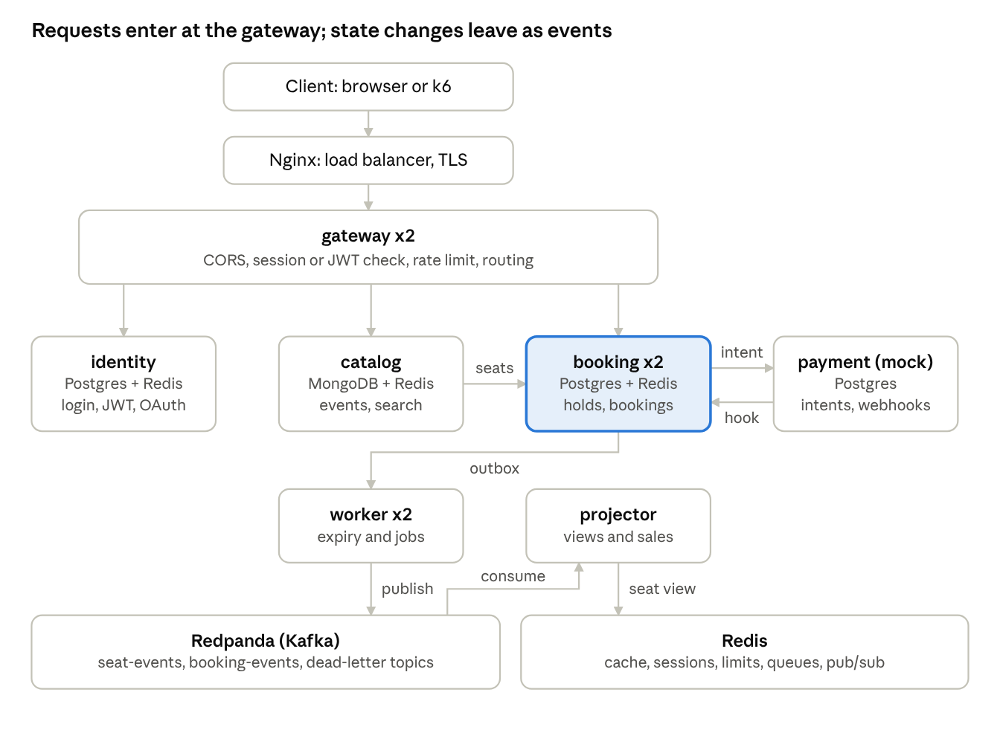
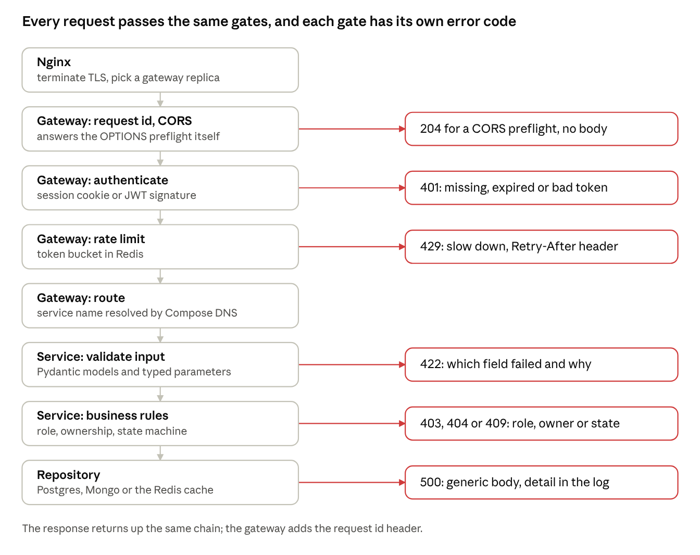
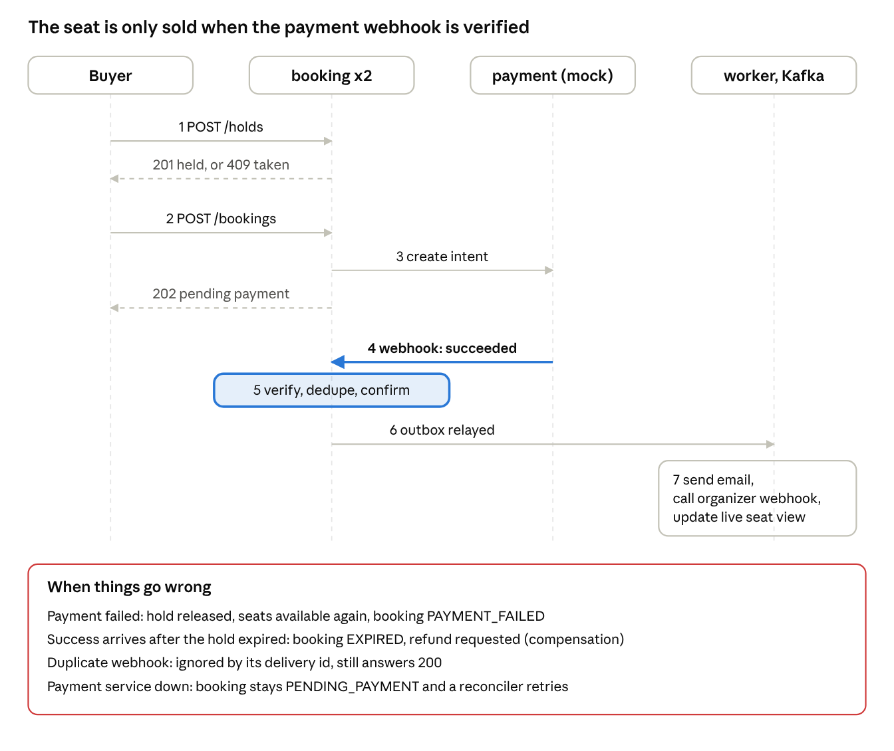
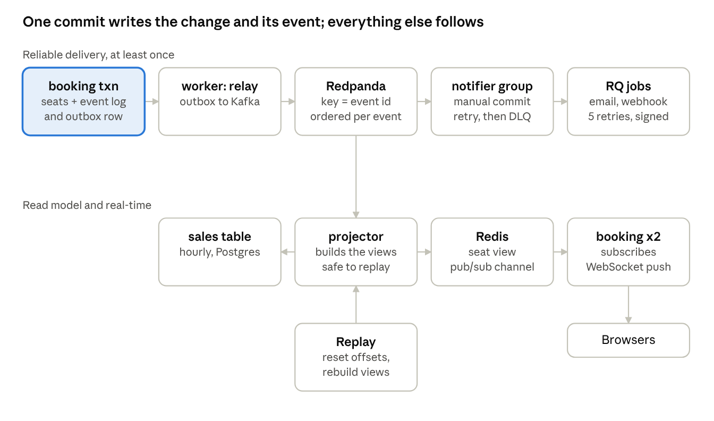
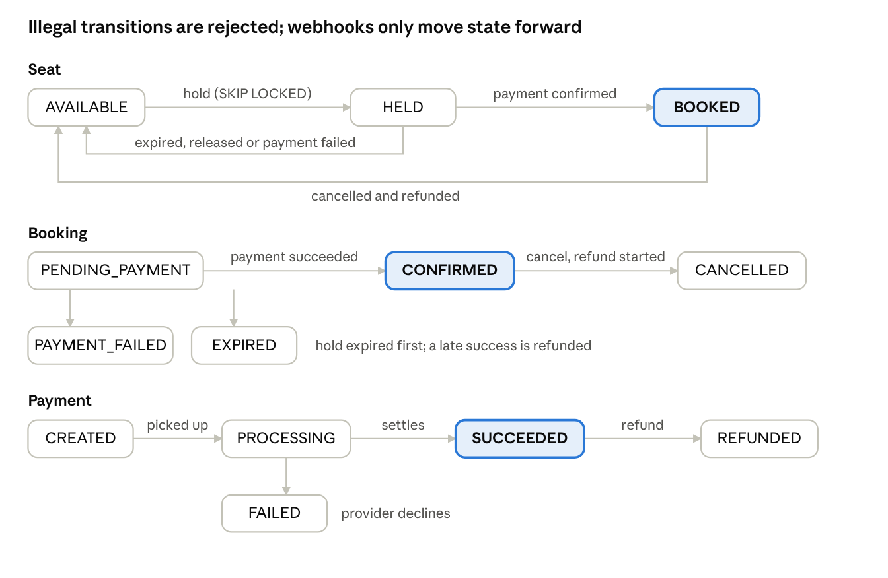

# TicketRush: Project Guide

## Overview

TicketRush is a flash-sale ticket booking platform split into 5 API services plus 2 background workers. It is built to exercise every one of the 68 sections in your backend syllabus in a single project, and its headline guarantee is simple: **the same seat is never sold twice, even when thousands of buyers click at once.**

**The problem it solves**

- A popular show opens: 50,000 seats, 20,000 buyers in the first minute.

- Everyone wants the same seats, payments are slow or fail, browsers reconnect, and webhooks arrive twice or out of order.

- The system must stay correct first and fast second.

**Guarantees the system makes (each one is a test you will write)**

- No double booking: one confirmed booking per seat, enforced by the database, not by hope.

- No double charge: a retried or double-clicked request does the work once (idempotency keys).

- Booking and payment never drift: duplicate, late or out-of-order payment webhooks are handled; a payment that arrives after the hold expired is refunded automatically.

- The live seat map is correct on every API replica, not only the one the buyer is connected to.

- When a dependency dies (Redis, payment service, Kafka), the system degrades instead of selling wrongly.

**What a user can do**

1.  Browse and search events (filter, sort, cursor pagination).

2.  Sign up and log in three ways: cookie session, JWT, or Google OAuth.

3.  Pick seats and hold them for 5 minutes, with a live seat map.

4.  Pay through a mock payment provider and get a confirmation email.

5.  Cancel and get a refund.

6.  As an organizer: create events, watch live sales, and receive signed webhooks for each sale.

**Stack**

| Layer                  | Choice                                           | Why                                         |
|------------------------|--------------------------------------------------|---------------------------------------------|
| Language and API       | Python 3.12, FastAPI, Pydantic                   | Matches your resume; async and typed        |
| Relational data        | PostgreSQL 16, SQLAlchemy 2, Alembic             | Transactions, locks, indexes, constraints   |
| Document data          | MongoDB 7                                        | Event catalog with flexible attributes      |
| Cache, queues, pub/sub | Redis 7, RQ                                      | Cache, rate limits, sessions, jobs, fan-out |
| Event streaming        | Redpanda (Kafka API, single node)                | Event log, consumer groups, replay          |
| Edge                   | Nginx                                            | Reverse proxy, load balancer, TLS           |
| Packaging              | Docker Compose, then Kubernetes (kind)           | Local multi-service, then orchestration     |
| Testing                | pytest, Testcontainers, k6, mutmut               | Test pyramid and proof numbers              |
| Observability          | Prometheus, Grafana, OpenTelemetry, Jaeger, Loki | Metrics, traces, logs                       |
| CI/CD                  | GitHub Actions                                   | Lint, test, build, scan, deploy             |

**Scope, honestly**

- This is much larger than a single-service project: expect about 4 to 5 weeks at 3 to 4 hours a day. Each phase ends with a working system, so you can stop early and still have something demonstrable.

- Design-only, written as short decision records and not built: multi-region deployment, full event sourcing, Kafka transactions.

- One tiny vanilla-JS front end is included, only because CORS, cookies, CSRF and WebSockets need a real browser to be learned properly.

## Concept coverage

All 68 sections of your syllabus appear in TicketRush; the table groups them by where you will meet them. Phases: P1 Foundations, P2 Identity, P3 Catalog, P4 Booking core, P5 Payments and saga, P6 Events and real-time, P7 Gateway and scale, P8 Observability, P9 Quality gates and CI, P10 Kubernetes and resilience, P11 Prove and ship.

| Syllabus sections                                                                                            | Where it appears in TicketRush                                                                                                                                        | Phase        |
|--------------------------------------------------------------------------------------------------------------|-----------------------------------------------------------------------------------------------------------------------------------------------------------------------|--------------|
| 1 Fundamentals: client-server, ports, DNS, localhost, processes, threads, sync vs async, blocking, stateless | Compose networking and service DNS names, uvicorn workers, a blocking-call experiment that stalls the event loop, stateless replicas                                  | P1, P7       |
| 2 to 6 HTTP, REST, routing, request processing, CRUD                                                         | Versioned REST API, status codes (201, 202, 409, 429), route groups, middleware chain, router to service to repository                                                | P1           |
| 3 REST extras: pagination, filtering, sorting, search, DTOs, OpenAPI                                         | Event search with filters, sort and cursor pagination; Pydantic request and response models; Swagger                                                                  | P3           |
| 7 CORS                                                                                                       | Tiny front end on another origin; preflight, credentials and cookies tested in a real browser                                                                         | P2           |
| 8 to 10 Authentication, sessions, JWT                                                                        | Argon2 passwords; cookie sessions in Redis (Secure, HttpOnly, SameSite); JWT access plus rotating refresh tokens                                                      | P2           |
| 11 OAuth                                                                                                     | Google login with the authorization code flow                                                                                                                         | P2           |
| 12 Authorization                                                                                             | Roles (attendee, organizer, admin) plus resource ownership checks                                                                                                     | P2           |
| 13 to 15 SQL, indexing, transactions                                                                         | Seat holds under FOR UPDATE SKIP LOCKED, partial indexes, EXPLAIN ANALYZE on 1M seats, ACID, rollback                                                                 | P4, P11      |
| 16 SQL vs NoSQL                                                                                              | Bookings and payments in PostgreSQL (consistency); event catalog in MongoDB (flexible attributes)                                                                     | P3, P4       |
| 17 to 19 Architecture, DI, interfaces                                                                        | Layered services, constructor injection, protocols for Clock, PaymentGateway, Cache, EventPublisher with fake and real versions                                       | P1, P4       |
| 20, 21 Caching and Redis                                                                                     | Cache-aside, read-through loader, write-through seat view, write-back view counters, TTL with jitter, LRU eviction, stampede lock, penetration and breakdown defenses | P3, P6       |
| 22, 23 Background jobs, message queues                                                                       | RQ workers (hold expiry, email, webhook delivery), retries, dead-letter queues, acknowledgements                                                                      | P6           |
| 24 to 26 Pub/sub, event-driven, real-time                                                                    | Redis pub/sub fan-out to WebSocket rooms; domain events through the outbox to Kafka                                                                                   | P6           |
| 27 to 29 Logging, errors, observability                                                                      | JSON logs with request and trace ids, central error handler, Prometheus metrics, OpenTelemetry traces, health checks                                                  | P1, P8       |
| 30 API performance                                                                                           | Connection pooling, pagination, caching, profiling, k6 numbers                                                                                                        | P7, P11      |
| 31 to 34 Rate limiting, gateway, load balancing, scalability                                                 | Token bucket in Redis, a gateway service, Nginx in front of replicas, read replica, 1 vs 2 vs 3 replica curve                                                         | P7           |
| 35, 36 Microservices, distributed systems                                                                    | Five services and two workers, REST between them, timeouts, retries, circuit breaker, saga with compensation, eventual consistency                                    | P5           |
| 37 Security                                                                                                  | Hashing, JWT and cookie hardening, CSRF token, XSS headers, parameterized SQL, secrets, TLS, SSRF and replay protection                                               | P2, P5, P9   |
| 38 Webhooks                                                                                                  | Inbound payment webhooks (HMAC on raw body, dedupe, out-of-order) and outbound organizer webhooks (retries, SSRF guard)                                               | P5, P6       |
| 39 to 47 Testing basics, pyramid, scope, doubles, mocking                                                    | Small, medium and large tests; fakes vs mocks; state vs interaction tests                                                                                             | P4, P9       |
| 48 Functional core, imperative shell                                                                         | Seat state machine, pricing, expiry decision, token bucket decision, signature check, retry delay as pure functions                                                   | P4           |
| 49 to 52 DB, network, time and hermetic testing                                                              | Testcontainers, a fake payment server, a fake clock, tests with no outside network                                                                                    | P9           |
| 53 to 57 TDD, flaky tests, coverage, mutation testing                                                        | Core written test-first; repeated runs to catch flakes; coverage gate; mutmut on the core                                                                             | P4, P9       |
| 58, 59 Complexity, linters, type checkers                                                                    | ruff with C901, mypy, formatters in CI                                                                                                                                | P9           |
| 60 to 63 CI/CD, deployment, Docker, Kubernetes                                                               | GitHub Actions, multi-stage Dockerfiles, Compose, kind cluster with probes and scaling                                                                                | P9, P10, P11 |
| 64 Distributed data and event systems                                                                        | Kafka topics, partitions keyed by event, consumer groups, offsets, event log, replay                                                                                  | P6           |
| 65 Consistency and reliability                                                                               | Idempotency, retries, timeouts, failure drills, backup and restore, RPO and RTO                                                                                       | P5, P10      |
| 66 Advanced architecture                                                                                     | CQRS (write model in Postgres, read model in Redis), append-only seat event log, sales data pipeline, multi-region as a written decision                              | P6, P10      |
| 67 Project-level concepts                                                                                    | FastAPI, Mongo, Redis, RQ, Compose, pytest, TestClient, AsyncMock all reused                                                                                          | throughout   |
| 68 Core mental models                                                                                        | The system flow diagrams in the next sections                                                                                                                         | P1 to P11    |

**Left out on purpose:** LangGraph, Qdrant, Gemini, MCP and SHAP. They are AI-specific, and your resume already shows them in SecondBrain and OutreachIQ.

## Services

Five API services and two background workers, each with its own data store and no shared tables. Services never read each other's databases; they call each other's APIs or react to events.

| Service          | Owns                                                                                                                             | Data store                                        | Replicas |
|------------------|----------------------------------------------------------------------------------------------------------------------------------|---------------------------------------------------|----------|
| gateway          | Single entry point: CORS, session or JWT check, rate limiting, request id, routing, health roll-up                               | Redis (limits only)                               | 2        |
| identity-service | Users, passwords, cookie sessions, JWT and refresh tokens, Google OAuth, roles                                                   | PostgreSQL identity_db, Redis (sessions)          | 1        |
| catalog-service  | Events, venues, seat layouts, search, view counters, organizer webhook endpoints                                                 | MongoDB, Redis (cache)                            | 1        |
| booking-service  | Seats, holds, bookings, inbound payment webhooks, WebSocket seat map, outbox                                                     | PostgreSQL booking_db, Redis (hold TTLs, pub/sub) | 2        |
| payment-service  | Mock payment provider: payment intents, refunds, signed webhooks with a chaos switch                                             | PostgreSQL payment_db                             | 1        |
| worker           | Hold expiry sweeper, outbox relay, notifier Kafka consumer, confirmation emails, outbound organizer webhooks, view-counter flush | Redis queues (RQ), reads booking_db               | 2        |
| projector        | Kafka consumer group that builds the seat-map view in Redis and the hourly sales table; owns the dead-letter topic and replay    | Redis, booking_db read schema                     | 1        |

**Supporting infrastructure:** Nginx (load balancer, TLS), PostgreSQL with one read replica, MongoDB, Redis, Redpanda (Kafka API), Mailpit (fake inbox), Prometheus, Grafana, Jaeger, Loki.

**How the services talk**

| From    | To                         | How                                                                  | Failure policy                                                                                                   |
|---------|----------------------------|----------------------------------------------------------------------|------------------------------------------------------------------------------------------------------------------|
| Client  | gateway                    | HTTPS through Nginx, WebSocket for the seat map                      | Rate limit returns 429                                                                                           |
| gateway | identity, catalog, booking | REST over Compose DNS names                                          | 3 second timeout; no retry on writes                                                                             |
| catalog | booking                    | REST POST /internal/events/{id}/inventory when an event goes on sale | Retries with backoff; event stays DRAFT until it succeeds                                                        |
| booking | payment                    | REST POST /payment-intents with an idempotency key                   | 2 second timeout, 2 retries with jitter, circuit breaker; booking stays PENDING_PAYMENT and a reconciler retries |
| payment | booking                    | Signed webhook                                                       | Up to 5 retries with exponential backoff and jitter                                                              |
| booking | Kafka                      | Outbox table, relayed by the worker                                  | At-least-once; consumers deduplicate                                                                             |
| Kafka   | projector                  | Consumer group, manual offset commit after processing                | Poison messages go to the dead-letter topic                                                                      |
| booking | Redis                      | Pub/sub channel per event                                            | Fire-and-forget; clients refetch the seat map on reconnect                                                       |
| worker  | organizer URL              | Signed outbound webhook                                              | HTTPS only, private IPs blocked, no redirects, 5 retries, then dead                                              |

Internal endpoints (/internal/\*) need a service token and are not routed by the gateway.

## System flow diagrams

Four pictures, from the whole system down to the details: the whole system, a request through the edge, booking and payment end to end, and events with real-time updates. The state machines are in the low-level design.

### 1. Whole system

whole system · 5 services, 2 workers, 2 data buses

Booking (highlighted) is the core: it holds the seats, asks payment for money, and publishes every change as an event. The worker relays the outbox to Redpanda and runs timed jobs; the projector turns events into the live seat view in Redis. Every service also uses Redis for its own needs, and metrics, traces and logs from all of them flow to Prometheus, Jaeger and Loki.

### 2. A request through the edge

request path · 8 gates, 6 early exits

This is your syllabus mental model (client, router, middleware, auth, handler, service, repository, database) with the gateway added in front. Red boxes are early exits: a request that fails a gate never reaches the next one.

### 3. Booking and payment end to end

booking and payment saga · 7 steps, 4 failure cases

This is a saga: booking and payment are separate services with separate databases, so there is no shared transaction. Each step is safe to retry, and each failure has a defined compensation instead of a hope.

### 4. Events and real-time

events and real-time · 2 consumer groups, 1 replay path

The outbox row is written in the same transaction as the seat change, so an event can never be lost or invented. Delivery is at least once, so every consumer deduplicates. The WebSocket path is best effort: if a client misses a message, it refetches the seat map when it reconnects. Reset the projector's offsets and the seat view rebuilds from the log.

## High-level design

TicketRush uses synchronous REST where a caller needs the answer now, and asynchronous events where the work can follow later. Every service owns its data; the only shared things are infrastructure (Redis, Redpanda).

**Data stores and why each exists**

| Store                   | Used for                                                               | Why this and not another                                                                       |
|-------------------------|------------------------------------------------------------------------|------------------------------------------------------------------------------------------------|
| PostgreSQL              | Identity, bookings and seats, payments, event log, outbox              | Needs ACID, row locks and unique constraints; money and seats must be exact                    |
| PostgreSQL read replica | Booking history and organizer sales queries                            | Moves read load off the primary; lets you observe replication lag                              |
| MongoDB                 | Event catalog, venues, seat layouts                                    | Events differ in shape (concert, match, play); read-heavy; no multi-row transactions needed    |
| Redis                   | Cache, sessions, rate limits, hold TTLs, RQ queues, pub/sub, seat view | One fast in-memory tool for many small jobs; none of it is the source of truth except sessions |
| Redpanda (Kafka API)    | Seat and booking event log, consumer groups, replay                    | Durable ordered log that several consumers read at their own pace                              |

**Consistency: where it is strong and where it is eventual**

| Area                 | Model                       | How it is enforced                                                |
|----------------------|-----------------------------|-------------------------------------------------------------------|
| Seat ownership       | Strong                      | One Postgres transaction with row locks; unique index as backstop |
| Booking and payment  | Eventual, with compensation | Saga: webhook confirms, refund undoes                             |
| Seat map in browsers | Eventual (seconds at most)  | Projector and pub/sub; refetch on reconnect                       |
| Catalog and cache    | Eventual (cache TTL)        | Invalidate on write, short TTL as a safety net                    |
| Sales numbers        | Eventual                    | Projector builds them from events                                 |

**Scaling plan**

- Every API service is stateless, so replicas can be added behind Nginx or the Compose and Kubernetes service name.

- WebSocket connections are per replica; Redis pub/sub makes a seat change reach every replica.

- The database is the real bottleneck: use a connection pool per replica, short transactions, SKIP LOCKED so waiters do not queue, and a read replica for reports.

- Hot keys (one popular event) are protected by a single-flight cache lock and by caching the seat view, not by querying Postgres per page view.

- Measure first: the 1, 2 and 3 replica k6 curve shows where adding replicas stops helping and the database becomes the limit.

**Failure handling**

| If this fails    | The system does this                                                                                                                                   |
|------------------|--------------------------------------------------------------------------------------------------------------------------------------------------------|
| Redis            | Rate limiting fails open for reads and closed for holds; cache misses go to the database; the seat map polls instead of pushing; bookings stay correct |
| payment-service  | Circuit breaker opens; booking stays PENDING_PAYMENT; reconciler retries; the hold expiry still frees seats                                            |
| Kafka            | Outbox rows pile up in Postgres and are relayed later; nothing is lost                                                                                 |
| A worker mid-job | The RQ job is retried; consumers deduplicate, so a repeat is harmless                                                                                  |
| booking replica  | Nginx health checks stop sending traffic; the other replica serves; clients reconnect their WebSocket                                                  |
| Postgres primary | Restore from backup (drill with a stated RPO and RTO); read replica promotion is described, not automated                                              |

**Security layers**

- Edge: TLS at Nginx, CORS allow-list, rate limits, request size limits.

- Identity: Argon2 hashes, short-lived access tokens, rotating refresh tokens with reuse detection, HttpOnly SameSite cookies plus a CSRF token for cookie sessions.

- Service to service: internal endpoints need a service token and are not routed by the gateway.

- Data: parameterized SQL only, output escaped, security headers, secrets from the environment and never in git.

- Webhooks: HMAC over the raw body with a timestamp, replay window, delivery-id dedupe, SSRF guard on outbound calls.

**Deployment**

- Docker Compose with profiles: core (services and data), events (Redpanda, projector), obs (Prometheus, Grafana, Jaeger, Loki).

- Kubernetes (kind) for the gateway and booking: Deployments, Services, ConfigMaps, Secrets, readiness and liveness probes, scaling with one command.

- CI/CD: lint and type check, small tests, medium tests with Testcontainers, image build, vulnerability scan, deploy on merge to main.

**Decisions to write down as short records**

1.  Postgres for bookings, Mongo for the catalog.

2.  Outbox pattern instead of publishing to Kafka inside the request.

3.  Saga with compensation instead of a distributed transaction.

4.  SKIP LOCKED holds instead of optimistic locking.

5.  At-least-once delivery plus idempotent consumers instead of exactly-once.

6.  Multi-region: not built; what would change and why.

## Low-level design

The design down to tables, endpoints, state machines, algorithms and code layout. Money is stored as integer paise, never as floats.

**Schema: PostgreSQL, one database per service**

| Database    | Table                                 | Key columns                                                                                  | Constraints and indexes                                                                                      |
|-------------|---------------------------------------|----------------------------------------------------------------------------------------------|--------------------------------------------------------------------------------------------------------------|
| identity_db | users                                 | id, email, password_hash, role, created_at                                                   | Unique on lower(email)                                                                                       |
| identity_db | oauth_accounts                        | provider, provider_user_id, user_id                                                          | Unique on (provider, provider_user_id)                                                                       |
| identity_db | refresh_tokens                        | id, user_id, family_id, token_hash, expires_at, revoked_at, replaced_by                      | Index on family_id; reuse of a revoked token revokes the whole family                                        |
| booking_db  | seats                                 | id, event_id, section, row_label, seat_no, tier, price_paise, status, hold_id                | Unique on (event_id, section, row_label, seat_no); partial index on (event_id, id) where status is AVAILABLE |
| booking_db  | holds                                 | id, user_id, event_id, status, expires_at, created_at                                        | Partial index on expires_at where status is ACTIVE                                                           |
| booking_db  | bookings                              | id, user_id, event_id, hold_id, status, total_paise, payment_id, idempotency_key, created_at | Unique on (user_id, idempotency_key); index on (user_id, created_at desc, id desc) for cursor paging         |
| booking_db  | booking_seats                         | booking_id, seat_id, active                                                                  | Unique on seat_id where active: the backstop against double booking                                          |
| booking_db  | seat_events                           | id (bigserial), event_id, seat_id, type, payload (jsonb), occurred_at                        | Append-only; index on (event_id, id)                                                                         |
| booking_db  | outbox                                | id (bigserial), topic, key, payload, created_at, published_at                                | Partial index on id where published_at is null                                                               |
| booking_db  | inbound_webhooks                      | provider_event_id, received_at, processed_at                                                 | Primary key on provider_event_id: the dedupe                                                                 |
| booking_db  | processed_messages                    | consumer, message_id                                                                         | Primary key on both: consumer dedupe                                                                         |
| booking_db  | webhook_endpoints, webhook_deliveries | organizer_id, url, secret; endpoint_id, event_id, attempts, next_attempt_at, status          | Index on (status, next_attempt_at)                                                                           |
| booking_db  | read.sales_hourly                     | event_id, hour, tickets, revenue_paise                                                       | Primary key on (event_id, hour)                                                                              |
| payment_db  | payments                              | id, booking_id, amount_paise, status, idempotency_key, provider_ref                          | Unique on idempotency_key                                                                                    |
| payment_db  | refunds, webhook_outbox               | payment_id, status; payment_id, type, payload, attempts, next_attempt_at, delivered_at       | Index on next_attempt_at where delivered_at is null                                                          |

**MongoDB catalog:** events (organizer_id, title, category, venue with city and location, starts_at, status, price_tiers, free-form attributes, view_count), seat_layouts (event_id, sections with rows and seats per row). Indexes: (city, starts_at), a text index on title, (organizer_id).

**API surface** (all under /v1 through the gateway unless marked internal)

| Service  | Endpoint                                                            | Notes                                                       |
|----------|---------------------------------------------------------------------|-------------------------------------------------------------|
| identity | POST /auth/register, POST /auth/login                               | Login returns an access and a refresh token                 |
| identity | POST /auth/session                                                  | Sets an HttpOnly cookie and returns a CSRF token            |
| identity | POST /auth/refresh, POST /auth/logout                               | Rotation; logout deletes the session and revokes the family |
| identity | GET /auth/google/start, GET /auth/google/callback                   | Authorization code flow with state check                    |
| identity | GET /me                                                             | Current user and role                                       |
| catalog  | GET /events                                                         | Query: q, city, from, to, sort, cursor, limit               |
| catalog  | GET /events/{id}                                                    | Cached; negative-cached when missing                        |
| catalog  | POST /events, PATCH /events/{id}                                    | Organizer only, own events only                             |
| catalog  | POST /events/{id}/publish                                           | Calls booking inventory; status becomes ON_SALE on success  |
| booking  | GET /events/{id}/seats                                              | Seat map snapshot from the Redis view                       |
| booking  | WS /ws/events/{id}                                                  | Live seat changes                                           |
| booking  | POST /holds                                                         | Idempotency-Key; 201, 409 (taken), 429 (too fast)           |
| booking  | DELETE /holds/{id}                                                  | Release your own hold                                       |
| booking  | POST /bookings                                                      | Idempotency-Key; 202 with PENDING_PAYMENT                   |
| booking  | GET /bookings/{id}, GET /me/bookings                                | Cursor paging, served from the read replica                 |
| booking  | POST /bookings/{id}/cancel                                          | Starts a refund                                             |
| booking  | POST /webhooks/payments                                             | Public, HMAC verified, deduplicated                         |
| booking  | GET /organizer/events/{id}/sales                                    | From the hourly sales table                                 |
| booking  | POST /organizer/webhooks, GET /organizer/webhooks                   | Register and list endpoints                                 |
| booking  | POST /internal/events/{id}/inventory                                | Internal: creates seats from a layout                       |
| payment  | POST /internal/payment-intents, POST /internal/payments/{id}/refund | Internal; idempotent                                        |
| payment  | POST /internal/chaos                                                | Sets delay, failure rate, duplicate and reorder switches    |
| all      | GET /healthz, GET /readyz, GET /metrics                             | Liveness, readiness (dependencies), Prometheus              |

**Error format and status codes:** every error is {"error": {"code", "message", "request_id", "details"}}. 400 bad request, 401 unauthenticated, 403 not allowed, 404 not found (also used when you do not own the resource), 409 conflict, 422 validation, 429 rate limited, 502 and 504 for failed upstream calls, 500 with a generic body.

**State machines**

state machines · seat, booking, payment

A pure function can_transition(machine, from_state, to_state) guards every change. A duplicate or late webhook that asks for an illegal move (for example FAILED after SUCCEEDED) is logged and ignored, never applied.

**Key algorithms**

1.  Hold seats (one transaction; sorted ids prevent deadlocks, SKIP LOCKED prevents waiting):

BEGIN;  
SELECT id FROM seats  
WHERE event_id = :event AND id = ANY(:ids) AND status = 'AVAILABLE'  
ORDER BY id  
FOR UPDATE SKIP LOCKED;  
-- fewer rows than requested: ROLLBACK and answer 409 with the taken ids  
INSERT INTO holds (...) VALUES (..., now() + interval '5 minutes');  
UPDATE seats SET status = 'HELD', hold_id = :hold WHERE id = ANY(:ids);  
INSERT INTO seat_events (...); -- append-only log  
INSERT INTO outbox (...); -- same commit as the change  
COMMIT;  
-- after commit: Redis SET hold:{id} with TTL, PUBLISH seats:{event}

2.  Hold expiry (worker, every 5 seconds; the database expires_at is the truth, the Redis TTL is only a countdown for the UI):

SELECT id FROM holds WHERE status = 'ACTIVE' AND expires_at \< now()  
ORDER BY expires_at LIMIT 100 FOR UPDATE SKIP LOCKED;  
-- per hold: status EXPIRED, seats back to AVAILABLE, seat_event + outbox

3.  Confirm from a payment webhook (one transaction):

verify HMAC over timestamp + "." + raw body, reject if older than 5 minutes  
INSERT INTO inbound_webhooks (provider_event_id) ON CONFLICT DO NOTHING  
no row inserted: duplicate, answer 200 and stop  
lock booking row; if can_transition(booking, status, target) is false: log, answer 200  
succeeded and hold still valid: booking CONFIRMED, seats BOOKED, hold CONVERTED  
succeeded and hold expired: booking EXPIRED, ask payment for a refund  
failed: booking PAYMENT_FAILED, seats AVAILABLE  
write seat_events and outbox rows, COMMIT, answer 200

4.  Idempotent create: INSERT ... ON CONFLICT (user_id, idempotency_key) DO NOTHING RETURNING id; no row returned means read and return the stored result, so a retry gets the same answer.

5.  Outbox relay: SELECT ... WHERE published_at IS NULL ORDER BY id LIMIT 100 FOR UPDATE SKIP LOCKED, publish to Kafka with the event id as the key, then set published_at.

6.  Rate limit: a token bucket kept in a Redis hash and updated by one Lua script, so the check and the update are atomic across gateway replicas. Login attempts use a sliding window per account and per IP.

7.  Retry delay: min(cap, base \* 2^attempt) with full jitter (a random value from 0 to that number), used for webhooks, reconciler and outbound calls.

8.  Cache read: check Redis; on a miss take SET lock NX EX; the winner loads from Mongo and fills the cache with a jittered TTL; the others wait briefly and re-read; a missing id is cached as a short-lived negative entry.

**Cache patterns, each used once on purpose**

| Pattern       | Where                                                                                        |
|---------------|----------------------------------------------------------------------------------------------|
| Cache-aside   | Event detail and search results in catalog                                                   |
| Read-through  | A CacheLoader wrapper that hides the miss path from handlers                                 |
| Write-through | Projector writes the seat view and publishes the change in one handler                       |
| Write-back    | Event page-view counters increment in Redis; a worker flushes them to Mongo every 30 seconds |
| Eviction      | Redis maxmemory with allkeys-lru, with a test that shows an eviction                         |

**Redis keys**

| Key              | Type            | Lifetime                     | Purpose                          |
|------------------|-----------------|------------------------------|----------------------------------|
| sess:{id}        | hash            | 24 h sliding                 | Cookie session data              |
| rl:{scope}:{id}  | hash            | 60 s idle                    | Token bucket state               |
| ev:{id}          | string          | 60 s plus jitter             | Cached event detail              |
| ev:{id}:view     | string or hash  | none, rewritten by projector | Seat map snapshot                |
| hold:{id}        | string          | 300 s                        | Hold countdown for the UI        |
| seats:{event_id} | pub/sub channel | none                         | Seat change fan-out to replicas  |
| views:{event_id} | counter         | none                         | Write-back page views            |
| RQ queues        | lists           | none                         | expiry, email, webhooks, default |

**Kafka topics**

| Topic                     | Key          | Events                                                   | Consumers                      |
|---------------------------|--------------|----------------------------------------------------------|--------------------------------|
| ticketrush.seat-events    | event_id     | seat.held, seat.released, seat.booked                    | projector                      |
| ticketrush.booking-events | event_id     | booking.created, confirmed, expired, cancelled, refunded | projector, notifier            |
| \*.dlq                    | original key | Messages that failed after retries, with the error       | You, for inspection and replay |

Consumers commit offsets only after processing, and record processed_messages so a redelivered message does nothing the second time.

**Functional core (pure functions, tested first and hardest)**

- can_transition(machine, from_state, to_state)

- choose_seats_outcome(requested_ids, locked_ids) returns held or the list of taken ids

- hold_expiry(now, created_at, ttl) and is_expired(now, expires_at)

- price_total(seats, fee_rules) in integer paise

- token_bucket_step(state, now, rate, burst) returns the new state and allowed or not

- next_retry_delay(attempt, base, cap, rand)

- verify_signature(secret, timestamp, raw_body, header, now, tolerance) in constant time

- is_blocked_ip(ip) for the SSRF guard (private, loopback, link-local, metadata ranges)

- decide_webhook_action(booking, event) returns apply, ignore or refund

**Code layout, same shape in every service**

ticketrush/  
services/  
booking/  
app/  
main.py \# composition root: builds dependencies, mounts routers  
api/ \# routers, request and response models, middleware  
services/ \# use cases: HoldService, BookingService, WebhookService  
domain/ \# pure functions and state machines, no I/O  
repositories/ \# SQL only; every method is tenant and user scoped  
adapters/ \# PaymentClient, EventPublisher, Cache, Clock (protocols + real + fake)  
workers/ \# RQ jobs, outbox relay, Kafka consumers  
db/ \# models, Alembic migrations  
tests/ \# small/ medium/ large/  
gateway/ identity/ catalog/ payment/ projector/  
libs/common/ \# logging, tracing, errors, config, signature helpers  
deploy/ \# compose files, nginx, k8s manifests, grafana, prometheus  
loadtest/ \# k6 scripts and results  
docs/adr/ \# decision records

**Defaults to start from**

| Setting                     | Value                                                               |
|-----------------------------|---------------------------------------------------------------------|
| Hold time                   | 5 minutes, at most 6 seats per hold                                 |
| Expiry sweep                | every 5 seconds, 100 holds per batch                                |
| Gateway limit               | 20 requests per second per user, burst 40                           |
| Hold endpoint limit         | 5 holds per minute per user per event                               |
| Login limit                 | 5 failures per 15 minutes per account and per IP                    |
| Webhook timestamp tolerance | 5 minutes                                                           |
| Webhook retries             | 5, base 2 seconds, cap 60 seconds, full jitter                      |
| Service call timeout        | 2 seconds, 2 retries, breaker opens after 5 failures for 30 seconds |
| Access token life           | 15 minutes; refresh token 7 days, rotated on use                    |

## Resume and interview

Your resume has two AI projects and no backend-centric one; TicketRush fills that gap. Replace every X below with a number you measured in Phase 11, and drop any claim you did not test.

**Resume entry, in the shape of your existing projects**

TicketRush \| GitHub \| Live  
Python 3.12, FastAPI, PostgreSQL, MongoDB, Redis, Kafka (Redpanda), Docker, Kubernetes, Prometheus, OpenTelemetry  
• Built a flash-sale ticket booking backend as 5 FastAPI services with an outbox-based event pipeline; held seats  
with row-level locking and proved zero double bookings across X concurrent buyers in a load test.  
• Designed idempotent booking and a payment saga with HMAC-verified, deduplicated webhooks and automatic refund  
compensation; handled duplicate, delayed and out-of-order callbacks.  
• Cut event-page p95 latency from X ms to Y ms with Redis caching (stampede-safe) and verified an EXPLAIN ANALYZE  
improvement of X ms to Y ms on 1M seat rows; sustained Z req/s on 2 replicas behind Nginx.  
• Shipped with CI/CD on GitHub Actions (Testcontainers integration tests, mutation-tested core, N% coverage),  
structured logs, Prometheus and Grafana dashboards, distributed tracing, and Kubernetes manifests.

**Skills line to add:** PostgreSQL, Kafka, Kubernetes, CI/CD (GitHub Actions), Prometheus and Grafana, OpenTelemetry, k6.

**Questions this project lets you answer with evidence**

- How do you stop two people buying the same seat? Row lock with SKIP LOCKED, a unique index as a backstop, and a concurrency test with N parallel buyers.

- What if the client retries a payment request? Idempotency key with a unique constraint; the retry returns the first result.

- What if the payment webhook arrives twice, late or out of order? Verify on the raw body, dedupe on the delivery id inside the transaction, and let the state machine refuse illegal moves.

- How do you publish events without losing any? Write an outbox row in the same transaction, relay it, make consumers idempotent.

- Why Mongo for the catalog and Postgres for bookings? Flexible read-heavy documents against exact transactional data.

- What happens when payment-service is down? Circuit breaker, a pending booking, a reconciler, and hold expiry that still frees seats.

- What did a cache stampede look like and how did you stop it? Show the load test before and after the single-flight lock.

- Where did scaling stop helping? Show the 1, 2, 3 replica curve and name the database as the limit.

**Be honest in interviews:** it is a learning-scale system on one machine, so say "tested with X concurrent users on a laptop", never "handles millions". Multi-region and full event sourcing are written decisions, not built features.
